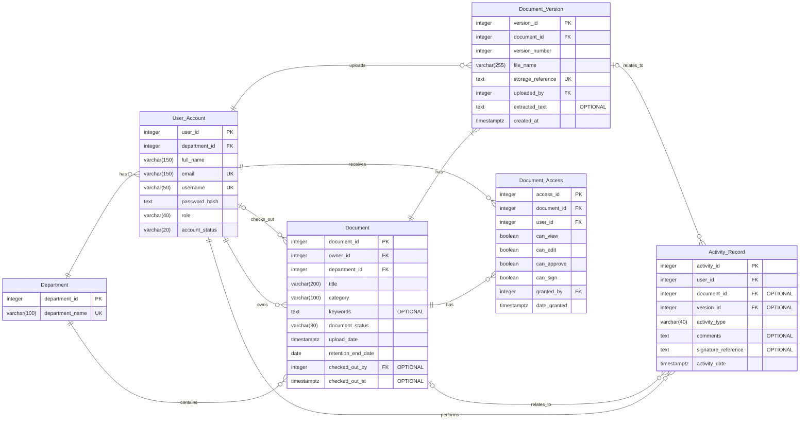

# Electronic Document Management System Database Design

## ER Diagram

The database design for the Electronic Document Management System (EDMS) consists of six tables: Department, User_Account, Document, Document_Version, Document_Access and Activity_Record.

Each table stores information about a particular part of the system. For example, the Department table keeps departmental details, while User_Account holds staff information and their assigned roles. The Document and Document_Version tables manage documents and their different versions. Document_Access controls user permissions, and Activity_Record keeps track of important actions performed within the system.

The diagram below shows how the six tables are connected and how information moves between them.

## 1. Understanding the Keys

Three types of keys are used in the database to identify records and link the tables together.

| Key | Description | Example in the EDMS |
|---|---|---|
| PK (Primary Key) | Identifies each record in a table. No two records have the same primary key. | `document_id` identifies each document. |
| FK (Foreign Key) | Links a record in one table to a record in another table. | `department_id` in User_Account links each staff member to their department. |
| UK (Unique Key) | Ensures that a value is not repeated where uniqueness is required. | The email field prevents two staff members from registering with the same email address. |

For example, when a staff member uploads a document, the system records their `user_id` as the document's `owner_id`. This makes it possible to identify who owns each document without repeating all the staff details in the Document table.

## 2. Relationships Between the Tables

The diagram uses Crow's Foot notation to show how many records can be associated with one another.

| Symbol | Meaning | Explanation |
|---|---|---|
| `||` | Exactly one | The relationship requires one record. |
| `o|` | Zero or one | The relationship is optional, but only one record is allowed. |
| `o{` | Zero or many | There may be several related records or none. |
| `|{` | One or many | At least one related record must exist. |

A few examples from the design help explain these relationships:

- **Department and User_Account:** A department can have several staff accounts, but each staff account belongs to one department.
- **Document and Document_Version:** Each document has at least one saved version. A document may have several versions as changes are made over time.
- **User_Account and Document_Access:** Different users can have access to different documents. The Document_Access table records the permissions assigned to each user.
- **User_Account and Activity_Record:** A staff member can perform several activities, such as uploading, reviewing or approving documents.
- **Document and Activity_Record:** An activity can relate to a particular document, although activities such as logging in do not need to be linked to a document.

This structure also allows a document to be checked out by one user or remain available without being checked out.

## 3. Optional Fields

Not every field needs to contain a value when a record is created. Some information only becomes available when a particular action takes place.

The following fields are optional in the design:

| Table | Field | Reason |
|---|---|---|
| Document | keywords | Keywords may not have been added when the document is uploaded. |
| Document | checked_out_by | A document may not be checked out by anyone. |
| Document | checked_out_at | This is only needed when a document is checked out. |
| Document_Version | extracted_text | Text is stored when OCR extraction is available. |
| Activity_Record | document_id | Some activities, such as login, are not linked to a document. |
| Activity_Record | version_id | Not every activity relates to a particular document version. |
| Activity_Record | comments | A comment is not necessary for every recorded activity. |
| Activity_Record | signature_reference | This is only required for signature-related activities. |

All other fields are required as specified in the database design.

## 4. Constraints and Transaction Management

Some requirements in the EDMS need additional checks to make sure that records remain accurate and that users follow the expected processes.

The following constraints and application checks address these requirements:

1. **Document versions:** A document must not have two versions with the same version number. This is handled through a unique constraint involving `document_id` and `version_number`. When a document is edited, a new version is saved rather than replacing the previous one.

2. **Document access:** A user should have only one access record for a particular document. A unique constraint on `document_id` and `user_id` prevents duplicate access entries.

3. **User roles and account status:** CHECK constraints restrict the role field to the seven agreed roles. The account status is limited to Active or Disabled. Document status is also restricted to Active, Archived or Disposed.

4. **Document retention:** The retention end date must not be earlier than the upload date. For example, a policy uploaded on 15 January 2026 with a five-year retention period has a retention end date of 15 January 2031. The application handles the archiving or disposal process when the retention period expires.

5. **Document checkout:** The application checks that the checkout user and checkout date are properly recorded when a document is checked out. These details are no longer applicable when the document is returned.

6. **Review and approval:** The application checks that a document goes through the required review stage before approval. This is necessary because a foreign key alone cannot control the order in which activities take place.

7. **Digital signatures:** A signature reference is required whenever an activity is recorded as a Signature. The application handles the actual signature verification.

8. **Activity tracking:** Important actions, including uploads, reviews, approvals, rejections and signatures, are recorded in Activity_Record. This provides a history of what happened and which user performed each action.

9. **Transaction management:** Database transactions help ensure that related changes are saved together. COMMIT saves the changes when an operation is successful, while ROLLBACK cancels the changes if an operation fails. This helps prevent incomplete updates to related records.

## 5. Design Assumptions

A few assumptions guide how the database is structured and how the system operates:

- Each staff member belongs to one department and has one assigned role.
- Each document has one owner and belongs to one department.
- Actual document files are stored outside the database. The database only keeps the file name and storage reference.
- OCR and AI processing take place within the application. The database stores the extracted text and categorisation results.
- Email notifications and signature verification are also handled by the application.
- The Activity_Record table provides a central record of important actions performed by users.

## Conclusion

The six tables provide the structure needed to manage documents and their associated activities within the organisation. They cover staff accounts, departmental records, document ownership, version history, access permissions and activity tracking.

The relationships between the tables help keep information organised and avoid unnecessary duplication. Primary keys, foreign keys and unique constraints also help maintain the accuracy of stored records.

Some requirements, particularly approval sequences, document checkout and retention management, need additional checks within the application. Together, the database structure and these checks provide a suitable foundation for the Electronic Document Management System.
