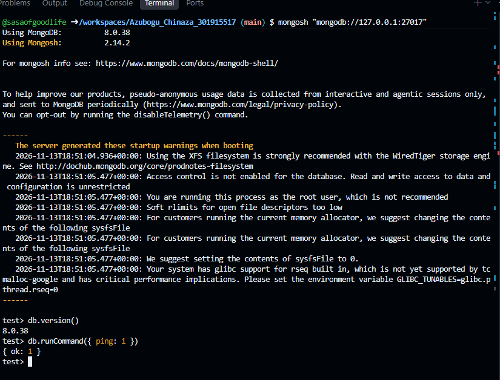

## Portfolio 4: NoSQL and Advanced Data Models

**Case Study:** Electronic Document Management System (EDMS)  
**Database Technology:** MongoDB  

---

# 1. MongoDB Environment Setup

MongoDB was installed and configured within the existing Ubuntu 24.04 GitHub Codespaces environment alongside PostgreSQL.

| Configuration | Details |
|---|---|
| Operating System | Ubuntu 24.04 |
| MongoDB Server | 8.0.38 |
| MongoDB Shell | 2.14.2 |
| Database Storage | `/workspaces/mongodb-data` |
| Connection Address | `127.0.0.1` |
| Port | 27017 |
| Environment | GitHub Codespaces |

The MongoDB database files are stored outside the coursework repository to keep database storage separate from project files.

# 2. Starting MongoDB

MongoDB was started manually using the following command:

```bash
sudo mongod --dbpath /workspaces/mongodb-data --bind_ip 127.0.0.1 --fork --logpath /tmp/mongod.log
```

The server started successfully and confirmed that the child process was running.

# 3. Connecting to MongoDB

The MongoDB Shell was opened using:

```bash
mongosh "mongodb://127.0.0.1:27017"
```

The connection was successful, and the MongoDB interactive shell displayed the `test>` prompt.

# 4. Connection Verification

The MongoDB server connection was verified using two commands.

### Version verification

```javascript
db.version()
```

**Observed result:**

```text
8.0.38
```

### Connection verification

```javascript
db.runCommand({ ping: 1 })
```

**Observed result:**

```javascript
{ ok: 1 }
```

The successful ping response confirmed that the MongoDB server was accessible and responding to database commands.

# 5. Screenshot Evidence

The following screenshot provides evidence of the MongoDB installation, successful connection and verification.



# 6. Reference

[MongoDB Official Ubuntu Installation Guide](https://www.mongodb.com/docs/v8.0/tutorial/install-mongodb-on-ubuntu/)

